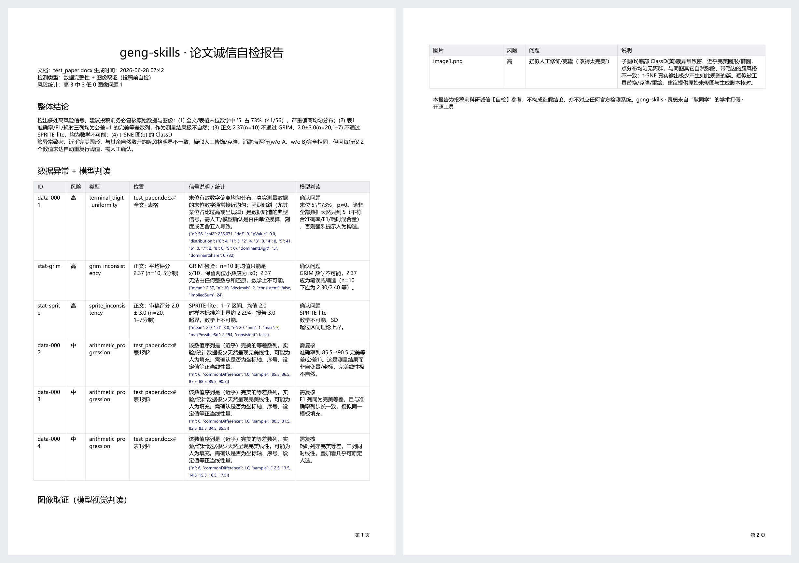

# geng-skills

> 论文投稿前的**科研诚信自检** skill — 在被别人打假之前，先用同样的方法检查自己的论文。
>
> 灵感来自["耿同学"的学术打假](https://zhuanlan.zhihu.com/p/2040725903106385012)。
> "耿"既是致敬，也取**耿直**之意。本工具面向作者本人自查，**不教任何人掩盖造假**。

支持 **LaTeX**（`.tex` / 工程目录）与 **Word**（`.docx`），从四个方向检查常见问题信号，最终导出 **PDF 报告**：

- **数值数据异常**：末位数字分布、Benford 定律、完美等差数列、重复数据块、重复行、GRIM 均值自洽、SPRITE-lite 标准差可能性。
- **报告的统计量**（v1.2 新增）：正文里 `t(28) = 2.20, p = .036` 这类结果按统计量和自由度**重算 p 值**（类似 statcheck），
  对不上就报，显著性结论反转的标为高风险；还会提示 p 值在 0.05 下方异常堆积（p-hacking 弱信号）。支持中文全角写法和 LaTeX 写法。
- **文本与参考文献**（v1.2 新增）：洗稿工具留下的"扭曲短语"（如 profound learning = deep learning）、正文引用编号超出参考文献列表、
  从未被引用或重复的条目；可选 `--verify-refs` 联网到 Crossref 核对 **DOI 是否存在、与标题是否相符、被引论文是否已撤稿**，
  用来发现 AI 幻觉生成的虚构引用。
- **图像 PS 痕迹**：抽取全部图片 + sha1 完全重复 + "一图多用"引用计数 + **感知哈希近重复检测**（v1.2 新增：
  把拼图切成子图，能发现缩放、重新保存、旋转、镜像后再用的子图，并生成并排对照图）+ 缩略图拼版，
  最终由 **AI 模型用视觉能力**判读复制重用、拼接、克隆/涂抹等痕迹。

> 设计哲学（与 [ai-check-skills](https://github.com/HoneyMeta/ai-check-skills) 一致）：
> **确定性脚本只筛信号，AI 模型负责判读**，以避免误报。脚本不下"造假"结论。

## 报告示例



> 自动导出 PDF：风险分级表（数据异常 + 模型判读）、图像取证表、整体结论与免责声明。
> 上图为对一份含人造数据 + 修饰过的 t-SNE 图的测试稿生成的报告。

## 为什么是 skill 而不是普通脚本

耿同学的工作流本质就是"**确定性统计/查重筛信号 + 人判断**"。这与 AI agent skill 的范式完全吻合：
脚本抽数据、跑统计、抽图片 → 模型判读（含看图）→ 生成报告。把它产品化、前置到投稿前，就是本 skill。

## 安装

本 skill 面向 AI 编程助手（Claude Code / Codex / OpenCode / Cursor / GitHub Copilot 等）。直接对你的 AI 说：

> **安装 https://github.com/HoneyMeta/geng-skills 这个技能**

AI 会把本仓库拉取到它的 skills 目录，装好后重启客户端即可生效。
也可以手动用通用的 skills 安装器：`npx skills add HoneyMeta/geng-skills`。

可选增强依赖（图片处理与近重复检测 + PDF 报告 + PDF 矢量图预览）：

```bash
pip install -r requirements.txt   # Pillow（图片）、reportlab（PDF）、PyMuPDF（可选）；缺失会自动降级
```
> 数据与文本检查零依赖即可运行（Python 3.9+，docx 用标准库解析）。

## 使用

安装后，把论文（`.docx` / `.tex` / LaTeX 工程目录）交给 AI，然后说：

> **使用 geng-skills 这个技能** 检查我这篇论文有没有数据/图像造假风险

AI 会按技能流程自动：抽数据跑取证统计、重算正文 p 值、检查参考文献 → 抽图片、跑近重复检测并用视觉判读 PS 痕迹 → 生成 PDF 报告。

想顺便核对参考文献是否真实存在、有没有引用已撤稿论文，可以说：

> **使用 geng-skills 检查这篇论文，并联网核对参考文献**

联网核对会把参考文献的 DOI 和条目文字发送到 Crossref 公共 API；不说就不会联网。

<details>
<summary>手动运行底层脚本（一般无需，AI 会自动调用）</summary>

```bash
# 1) 数据取证 + p 值重算 + 参考文献检查（--verify-refs 时联网核对 DOI/撤稿）
python scripts/geng_check.py data   --input paper.tex  --out findings.json [--verify-refs]
# 2) 抽取图片（之后由 AI 看图判读）
python scripts/geng_check.py images --input paper.docx --out-dir extracted_images --contact-sheet
# 3) GRIM / SPRITE-lite（按需）
python scripts/geng_check.py grim   --mean 3.45 --n 20 --decimals 2          # 多题量表加 --items 5
python scripts/geng_check.py sprite --mean 2.0 --sd 3.0 --n 20 --min 1 --max 7
# 4) 生成报告（合并 AI 判读 verdicts.json）
python scripts/geng_check.py report --findings findings.json --verdicts verdicts.json --out report.pdf
```
</details>

完整工作流、判读尺度与各检查项含义见 [SKILL.md](SKILL.md) 与 [references/](references/)。

## 输出

- `findings.json` — 数据、统计量、文本与参考文献信号（type / severity / location / stat / explanation）。
- `extracted_images/` + `manifest.json` — 全部图片、尺寸、sha1、引用次数、完全重复分组（`exactDuplicateFiles`）、
  一图多用（`reusedImages`）、近重复子图（`nearDuplicates`，附 `_near_dup_*.png` 对照图）、缩略图拼版；
  LaTeX 的 PDF 矢量图另有 `*.preview.png`。
- `report.pdf`（或降级 `report.html`）— 风险分级表 + 图像判读 + 整体结论 + 免责声明。

## 检查项一览

| 方向 | 检查 | 信号 |
|---|---|---|
| 数据 | 末位数字均匀性 | 卡方偏离（如 2400 个末位全 5）；小样本用精确二项检验 |
| 数据 | Benford 首位数字 | 跨数量级数据的首位偏离 |
| 数据 | 等差数列 | 测量列呈完美线性 |
| 数据 | 重复数据块 / 行 | 跨样本复制粘贴（"均值 ± SD"中的 SD 也参与比对） |
| 数据 | 小数位异常不一致 | 同列精度混杂（弱信号） |
| 数据 | GRIM | 报告均值数学上不可能（支持多题量表） |
| 数据 | SPRITE-lite | 有界数据的报告标准差超理论上界 |
| 统计量 | p 值重算 | t / F / r / χ2 / z 的报告 p 值与统计量、自由度不符；显著性反转为高风险 |
| 统计量 | p 值堆积 | 精确 p 值在 0.04–0.05 明显多于 0.03–0.04（弱信号） |
| 文本 | 扭曲短语 | 洗稿工具把术语换成字面同义词（profound learning、irregular woodland…） |
| 参考文献 | 编号与列表 | 引用编号超出列表、条目从未被引用、重复条目、LaTeX 未定义的 `\cite` |
| 参考文献 | 联网核对（可选） | DOI 不存在 / 与标题不符、被引论文已撤稿或有关注声明 |
| 图像 | 完全重复文件 | sha1 一致（脚本自动） |
| 图像 | 一图多用 | 同一图片文件在文中插入多次（脚本自动，docx 靠引用计数） |
| 图像 | 近重复子图 | 感知哈希，覆盖缩放、重存、裁进拼图、旋转、镜像（脚本自动，需看图确认） |
| 图像 | 复制/拼接/克隆/涂抹 | AI 视觉判读 |

## 限制

- 图像仅做**篇内**比对，不做跨论文/全库比对（需 ImageTwin、Proofig 等外部数据库）；近重复检测只看照片类子图，
  子图内部的局部克隆仍靠看图。
- 依赖能从表格 / `tabular` 解析出数值；图片里的数据无法读取。
- p 值重算只覆盖正文写全统计量和自由度的检验；只写 `p < 0.05` 的结果无法检查。
- 联网核对只覆盖 Crossref 收录的文献；多数中文期刊、书籍、学位论文、网页查不到属正常，查不到≠不存在。
- 所有结论需人工/模型确认；本工具只提供线索与报告，**不构成造假认定**，也不对应任何官方检测系统。

## English

geng-skills is a pre-submission research-integrity **self-check** skill for AI assistants (Claude Code, Codex,
OpenCode, Cursor, GitHub Copilot…). It reads LaTeX (`.tex` or a project folder) and Word (`.docx`) papers and
produces a PDF report. Deterministic scripts flag candidate problems; the AI model reviews each one (including
looking at the images) and writes the verdicts. Nothing in the report is a finding of misconduct.

What it checks:

- **Numbers in tables and text**: terminal-digit uniformity, Benford's law, perfect arithmetic sequences,
  duplicated data blocks and rows, GRIM and SPRITE-lite (on request). Reference-list years and page numbers are
  excluded from the digit statistics.
- **Reported statistics** (new in v1.2): `t(28) = 2.20, p = .036`, `F(2, 57) = …`, `r(48) = …`, `χ2(1) = …` and
  `z = …` are recomputed from the statistic and degrees of freedom, statcheck-style, allowing for rounding.
  A flipped significance decision is high risk; a result that only matches a one-tailed test is low. Chinese
  full-width and LaTeX notation are supported. A pile-up of exact p values just below .05 is reported as a weak
  p-hacking signal.
- **Text and references** (new in v1.2): tortured phrases left by paraphrasing tools ("profound learning" for
  deep learning), citation numbers beyond the reference list, uncited and duplicated entries, undefined LaTeX
  `\cite` keys. With `--verify-refs` (only after the user agrees) DOIs are checked on the Crossref API: DOI not
  found, DOI that belongs to a different title, cited work with a retraction or expression-of-concern notice.
  This helps catch fabricated (hallucinated) references.
- **Images**: every figure is extracted; byte-identical files, the same image inserted twice, and (new in v1.2)
  perceptual-hash near-duplicates: figures are split into panels and photo-like panels are compared under
  8 rotations/mirrorings, so resized, re-saved, cropped, rotated or mirrored reuse is found. Side-by-side preview
  images are written for the model to inspect.

Install by telling your AI assistant:

> **Install the skill at https://github.com/HoneyMeta/geng-skills**

Then: **"Use geng-skills to check my paper for data and image integrity problems"** (add "and verify the
references online" to allow Crossref lookups). Optional dependencies: `pip install -r requirements.txt`.

Limits: image comparison is within the paper only (no cross-paper database such as ImageTwin or Proofig);
p-value recomputation needs the full statistic and degrees of freedom in the text; online verification only
covers works registered with Crossref, so "not found" means "check by hand", not "does not exist".

## License

MIT
